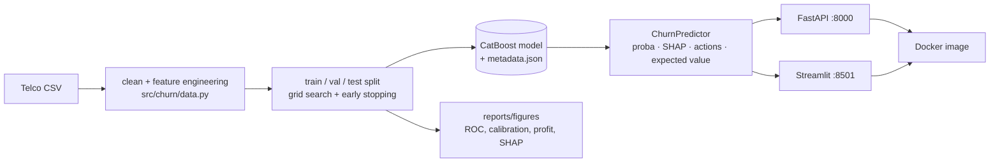
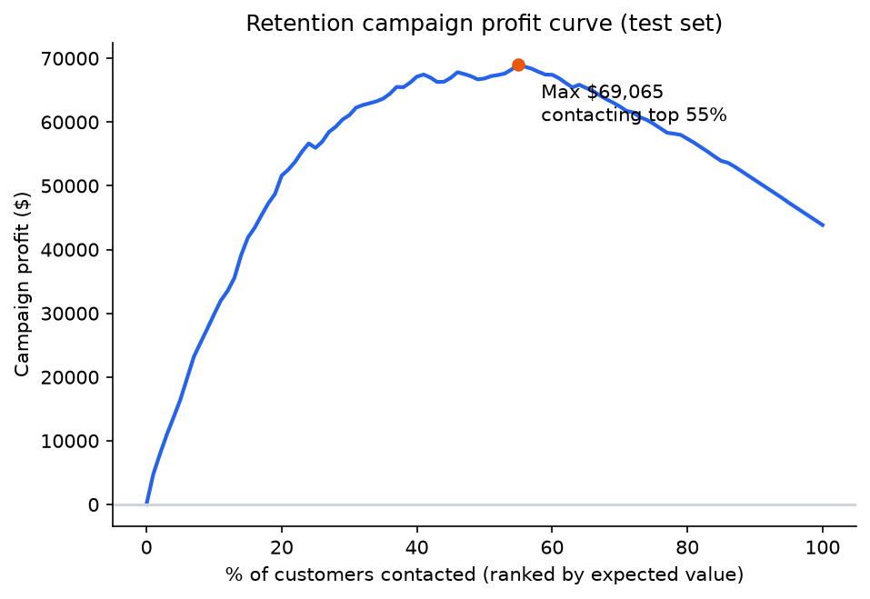
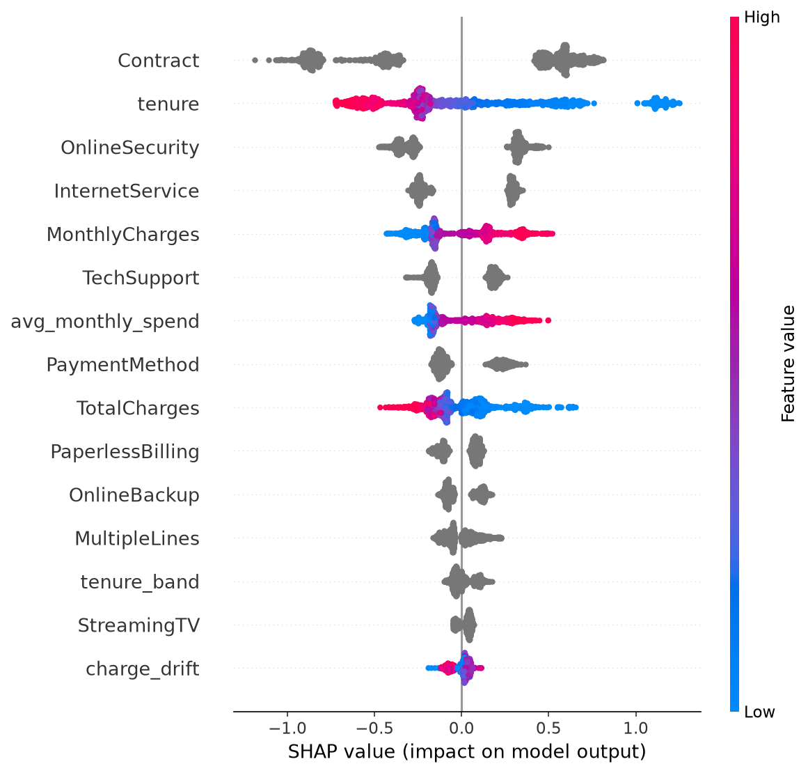

# Customer Churn Prediction & Explainable ML

**Predict which telecom customers will leave, explain *why* for each one, and decide *who is worth a retention offer*.**

CatBoost · SHAP · FastAPI · Streamlit · Docker · GitHub Actions

---

## TL;DR

| | |
|---|---|
| **Problem** | 26.5% of customers churn. Retention offers cost money, so you can't send one to everyone. |
| **Model** | CatBoost on native categorical features, tuned on validation log loss, 5-fold CV ROC-AUC **0.852 ± 0.008** |
| **Held-out test** | ROC-AUC **0.845**, PR-AUC **0.669**, top-decile lift **2.8×**, **51%** of churners found in the top 20% of risk scores |
| **Business result** | Expected-value targeting earns **$66.9k** on the test set vs **$58.4k** for an F1-optimised probability threshold (+15%) and **$43.9k** for contacting everyone (+53%) |
| **Explainability** | Global + per-customer SHAP, each driver mapped to a concrete retention action, and what-if simulation of retention levers |
| **Serving** | FastAPI (`/predict`, `/predict/batch`, `/explain`, `/model/info`), Streamlit UI, single Docker image, CI with a model quality gate |

## Architecture



`ChurnPredictor` (`src/churn/predict.py`) is the single inference path. The API and the UI both call it, so they can never disagree.

## What makes this more than a notebook

1. **Decisions, not just probabilities.** Each customer gets an *expected value of contact*:
   `P(churn) × save rate × 12 months of revenue − offer cost`. Contacting only customers with a positive value beats any single probability cutoff. A high-paying customer at 30% risk can be worth more than a low-paying one at 70% risk.
2. **Honest evaluation.** The model is compared with a tuned logistic-regression baseline on the same split. Calibration is checked (Brier score, reliability curve) because the dollar maths relies on probabilities being right, not just well ranked. The test set is touched only once.
3. **Explanations a retention team can act on.** SHAP contributions are mapped to actions ("month-to-month contract → offer a 1-year upgrade"). An action is suggested only when that feature is actually raising *this* customer's risk.
4. **What-if analysis.** The UI re-scores the customer under realistic levers (contract upgrade, add Tech Support, auto-pay, 10% discount) and ranks them by risk reduction.
5. **Production hygiene.** Pydantic validation rejects impossible inputs (e.g. "no phone service" plus "multiple lines"). Model metadata records the data hash, parameters and metrics. CI retrains from scratch and fails if quality drops below a threshold. The same image serves both API and UI.

## Results

<p align="center">
  
  
</p>

| Metric (test, n = 1,409) | CatBoost | Logistic regression |
|---|---|---|
| ROC-AUC | 0.845 | 0.846 |
| PR-AUC | **0.669** | 0.655 |
| Brier score ↓ | **0.135** | 0.136 |
| F1 @ val-tuned threshold | **0.625** | 0.618 |
| Recall in top 20% | **51.3%** | 50.0% |

> **A note on the baseline:** on this dataset a well-specified logistic regression is almost as good as gradient boosting. The signal is dominated by a few strong, nearly monotonic drivers (contract, tenure, internet type). CatBoost is slightly better on precision-recall and calibration, handles categorical features without one-hot encoding, and gives exact, fast TreeSHAP explanations. Checking that the extra complexity is worth it is part of the job.

### Key findings

| Driver | Churn rate |
|---|---|
| Month-to-month vs two-year contract | **42.7%** vs 2.8% |
| Tenure 0–6 months vs 49+ months | **52.9%** vs 9.5% |
| Fiber optic vs DSL internet | **41.9%** vs 19.0% |
| Electronic check vs automatic card payment | **45.3%** vs 15.2% |
| No Online Security vs has it (internet users) | **41.8%** vs 14.6% |

SHAP confirms these are the model's main drivers. The engineered `avg_monthly_spend` and `charge_drift` (current bill vs. historical average) add signal about recent price changes.

More figures: [ROC / PR](reports/figures/roc_pr.png) · [calibration](reports/figures/calibration.png) · [cumulative gains](reports/figures/gains.png) · [SHAP importance](reports/figures/shap_bar.png) · [Model card](MODEL_CARD.md)

## Quickstart

```bash
make install            # uv venv (Python 3.12) + all deps
source .venv/bin/activate
make train              # ~1 min; writes models/ and reports/figures/
make test               # 22 tests: data, model quality gate, SHAP additivity, API, UI
make app                # http://localhost:8501
make api                # http://localhost:8000/docs
```

Or with Docker:

```bash
docker compose up --build   # API on :8000, Streamlit on :8501
```

## API

```bash
curl -X POST "localhost:8000/explain?top_k=3" \
  -H "content-type: application/json" -d @tests/sample_customer.json
```

```json
{
  "churn_probability": 0.8031,
  "risk_tier": "high",
  "expected_value_of_contact": 272.79,
  "recommend_contact": true,
  "base_value": -1.6385,
  "contributions": [
    {"feature": "tenure", "value": 3, "shap_value": 0.6219},
    {"feature": "Contract", "value": "Month-to-month", "shap_value": 0.443},
    {"feature": "OnlineSecurity", "value": "No", "shap_value": 0.312}
  ],
  "actions": [
    "Enrol in new-customer success / onboarding outreach.",
    "Offer a discounted 1- or 2-year contract upgrade.",
    "Bundle a free 3-month Online Security trial."
  ]
}
```

| Endpoint | Purpose |
|---|---|
| `GET /health` | Liveness + model loaded |
| `GET /model/info` | Version, training date, data hash, params, metrics, global importance |
| `POST /predict` | Probability, risk tier, expected value, contact decision |
| `POST /predict/batch` | Same for up to 10k customers |
| `POST /explain` | Prediction + SHAP contributions + suggested actions |

## Project structure

```
src/churn/
  config.py      feature lists, paths, retention economics assumptions
  data.py        cleaning + feature engineering (shared by training and serving)
  train.py       split, tuning, CV, baseline, SHAP, figures, metadata
  evaluate.py    ML metrics, lift/gains, campaign profit simulation
  predict.py     ChurnPredictor: scoring, SHAP explanations, actions
  plots.py       report figures
api/             FastAPI app + Pydantic schemas
app/             Streamlit app
tests/           pytest suite (data, model, API, UI)
models/          trained model + metadata.json
reports/figures/ generated evaluation plots
```

## Assumptions & limitations

- **Economics are illustrative.** $50 offer, 35% save rate and a 12-month value horizon live in `config.RetentionEconomics`. In practice these would come from past campaigns or an A/B test.
- **What-ifs are associations, not causal effects.** A customer who chooses a two-year contract differs from one who is pushed into it. Uplift modelling or experiments are the right tool for estimating treatment effects.
- **One static snapshot.** The data is a single public snapshot with no timestamps, so there's no out-of-time validation and no drift monitoring.

## Possible extensions

- Uplift modelling (T-learner / causal forest) to target *persuadable* customers rather than *at-risk* ones
- Survival analysis (time-to-churn) using tenure
- Drift monitoring (Evidently) and MLflow experiment tracking
- Deploy to Streamlit Community Cloud / Render / Hugging Face Spaces

## Data

[IBM Telco Customer Churn](https://github.com/IBM/telco-customer-churn-on-icp4d): 7,043 customers, 19 features, binary churn label.
